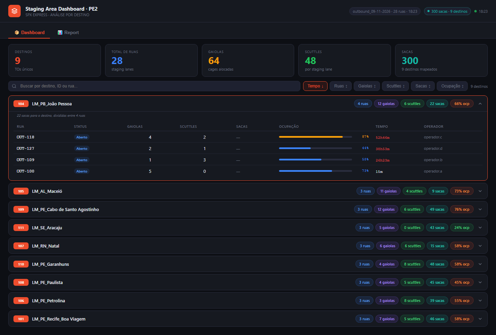
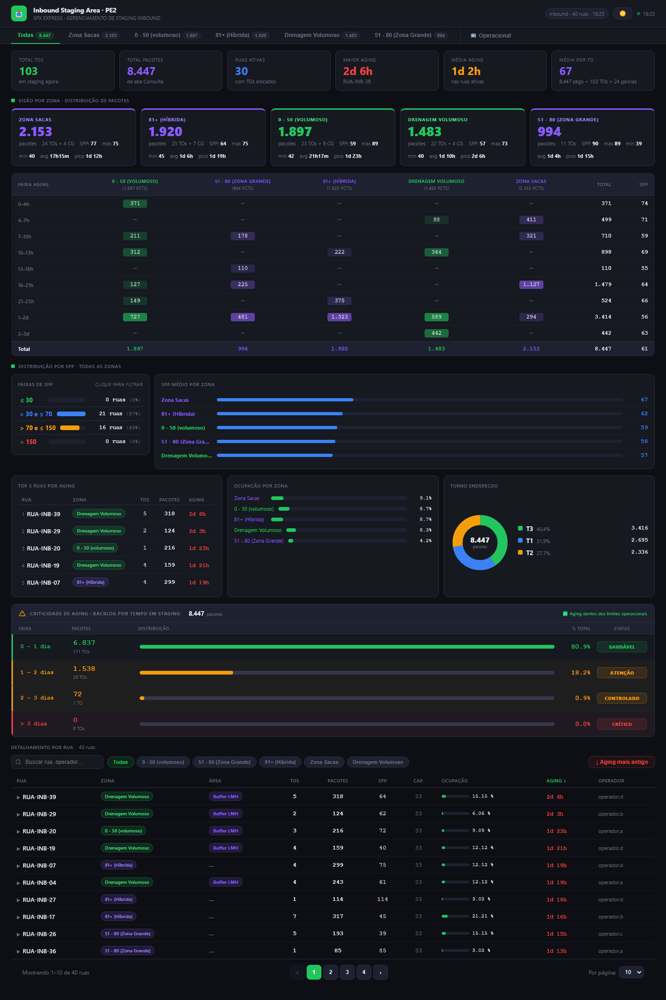
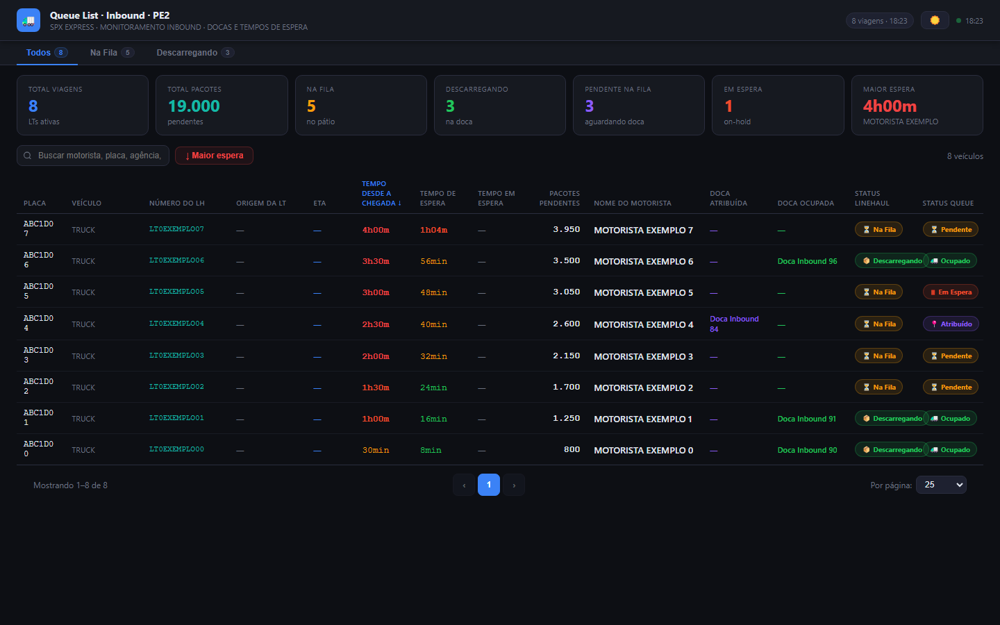
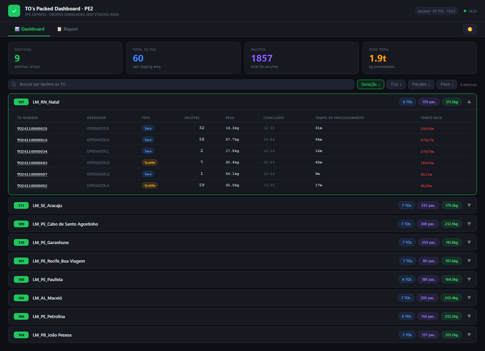
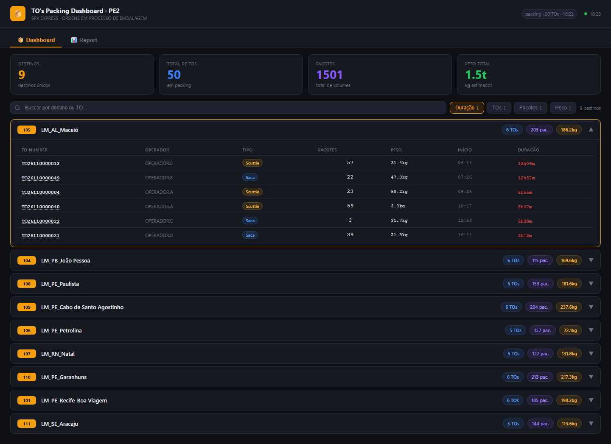
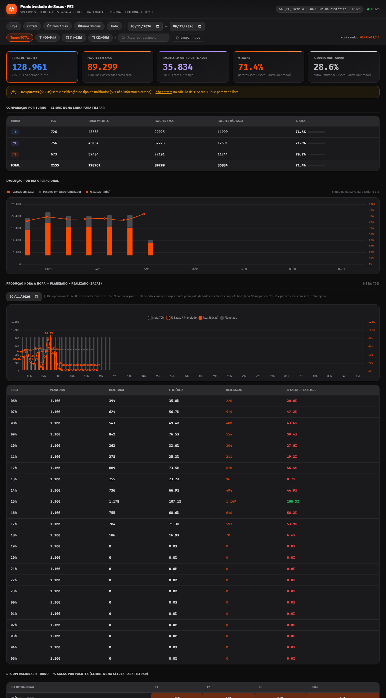
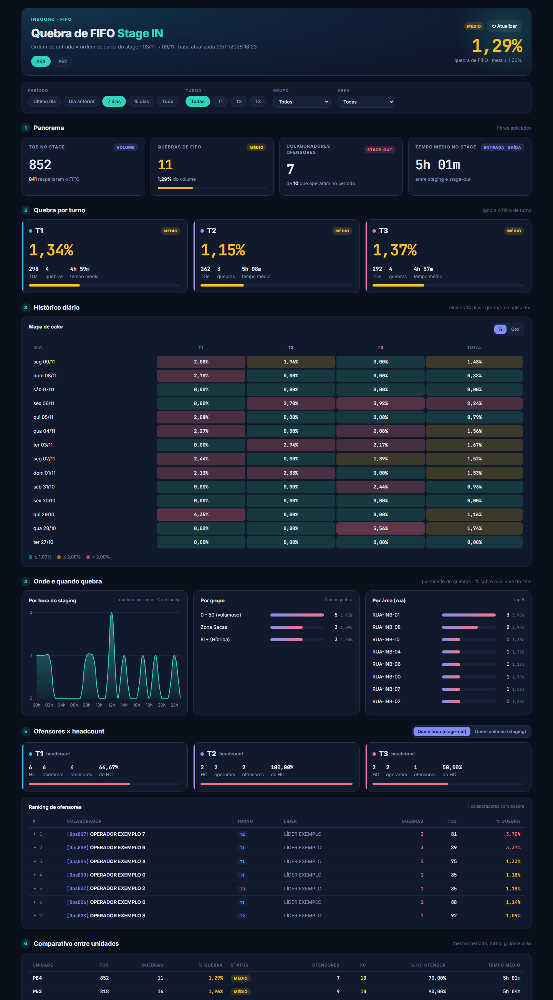

# Dashboards SPX — SoC PE2 (Jaboatão) e PE4 (Recife 04)

Coleção de painéis operacionais em **Google Apps Script** (web apps) que leem planilhas do Google Sheets
alimentadas pelas extrações do SPX, mais o **report diário de quebra de FIFO** enviado ao Seatalk.

Cada painel existe em duas cópias (PE2 e PE4) com **o mesmo código** — só muda a planilha de origem e o
rótulo da unidade no `CONFIG` do `Code.gs`.

| # | Dashboard | O que mostra | README | Preview |
|---|---|---|---|---|
| 01 | **Staging Area (Stage OUT)** | Ruas de expedição por destino, ocupação, gaiolas, sacas; Report com farol de aging (>24h) e justificativas | [README](dashboards/01-stage-out/README.md) |  |
| 02 | **Inbound Staging (Stage IN)** | Ruas de recebimento por zona, pacotes, SPP, aging, visão Volumoso e Operacional | [README](dashboards/02-stage-in/README.md) |  |
| 03 | **Queue List · Inbound** | Fila de veículos do inbound: espera, docas, status | [README](dashboards/03-queue-list/README.md) |  |
| 04 | **TO's Packed** | TOs fechadas ainda sem staging area, por destino; Report com farol, turnos e ruas disponíveis | [README](dashboards/04-tos-packed/README.md) |  |
| 05 | **TO's Packing** | TOs em embalagem, tempo em packing; Report com farol e turnos | [README](dashboards/05-tos-packing/README.md) |  |
| 06 | **Produtividade de Sacas** | % de pacotes em saca por dia operacional/turno, hora a hora × planejado | [README](dashboards/06-produtividade-sacas/README.md) |  |
| 07 | **FIFO Stage IN** | Quebra de FIFO no stage de entrada, ofensores × headcount (PE2 + PE4 num só painel) | [README](dashboards/07-fifo-stage-in/README.md) |  |
| — | **Report FIFO no Seatalk** | Mensagem + imagem diária de quebra de FIFO (Python + GitHub Actions) | [README](report-fifo-seatalk/README.md) | — |

> As imagens de preview usam **dados fictícios** (geradas por `tools/gerar_previews.py`).

## Links de acesso (web apps)

Abrir logado com conta **@shopee.com** (o acesso é restrito ao domínio).

| Dashboard | PE2 | PE4 |
|---|---|---|
| Stage OUT | [abrir](https://script.google.com/a/macros/shopee.com/s/AKfycbzHHMx-OIPcZVzcopNUia59oZoNFAvdbZPulURMPOKkyV53SYpcqkUYpsTOp3DIa25LuA/exec) | [abrir](https://script.google.com/a/macros/shopee.com/s/AKfycbyBGhseVjSCIGpDwTUxmjNc6aThRaxSZhIjOIptAD01fTdodydz8oCuMggxQbsh-NLIRg/exec) |
| Stage IN | [abrir](https://script.google.com/a/macros/shopee.com/s/AKfycbzJaq4X3EfyNhmFu_bMYBWdefIbQz1lzHwyZ-DPsFFt2vKfuHK8nF8WukuBM9Dvh0qm/exec) | [abrir](https://script.google.com/a/macros/shopee.com/s/AKfycbz1KeC2LE6OOVV6VOw61Rmo-wwtYhBq1TAcuH3EgcQ9eCBktNIge2H01S6-lDF68-f7aw/exec) |
| Queue List | [abrir](https://script.google.com/a/macros/shopee.com/s/AKfycbyd5D6sA2tuRHzoTgp4pRwTXVSqK337qHs3zOdn41jCNWntgBTG3M6AtU6QK-7Hs71wYg/exec) | [abrir](https://script.google.com/a/macros/shopee.com/s/AKfycbyo55xuNfibeRthH5SfgoKRE65Mo4RaOxmg3OOeq52Sq9J9_WNajxA8q1293DRpnyn_Bw/exec) |
| TO's Packed | [abrir](https://script.google.com/a/macros/shopee.com/s/AKfycbyEuVftFQvcd66LW3A3MBe0sETox3kmT4LUnyfAtG5n6J81TwD3tGPt3fo1BSlhwQM/exec) | [abrir](https://script.google.com/a/macros/shopee.com/s/AKfycbxDo43TOdwQhvc6_U1hO9Nso8KbfyQVEfWcQ4_Sv2FNboVGBeyzquuD0rDNpIjyTFC-/exec) |
| TO's Packing | [abrir](https://script.google.com/a/macros/shopee.com/s/AKfycby7yXnsVuZR5pC7lXPk6q6L_bVb4OoqpM7if0fdWOWlZUBP9ZTs2tbUNURNQm9YahEB/exec) | [abrir](https://script.google.com/a/macros/shopee.com/s/AKfycbwHppGkkWEuLaeOk5YU2yBmzp-_T6kC2_WEhRL37A7m4IZ_Sah3Rq2mq0QY1QerCyNY/exec) |
| Produtividade de Sacas | [abrir](https://script.google.com/a/macros/shopee.com/s/AKfycbwCff3M6jVGI3DbiP3Ce-uwTDNkYScUG_zuOYxaOeRrRo_Ywn47Zutjm0PufWDgFBPo/exec) | [abrir](https://script.google.com/a/macros/shopee.com/s/AKfycbydJnPkhf1EL4ZkLq8jDkx-ZJYci8E9iR72r96R08Q0DwwKsgHYIzljEtefBVTJQUhT/exec) |
| FIFO Stage IN | [abrir (PE2 + PE4)](https://script.google.com/a/macros/shopee.com/s/AKfycbymhO0ljXXcgPygiGrbvtjxC0_1kPpPA49hY8Acf18XSHM_OKHcHlkwfQoC7KA3_U7h/exec) | ↔ |

IDs de planilha, projeto Apps Script e implantação de cada um: [`tools/catalogo.py`](tools/catalogo.py).

## Estrutura do repositório

```
dashboards-collection/
├── README.md                     ← este arquivo (índice + manutenção comum)
├── dashboards/
│   └── NN-nome/
│       ├── README.md             ← documentação do painel (regras, fontes, como ajustar)
│       ├── preview-*.png         ← imagens do layout (dados fictícios)
│       ├── pe2/  pe4/            ← código de cada projeto Apps Script (igual ao que está no ar)
│       │   ├── Code.gs           ← servidor: lê a planilha, monta o JSON, cache
│       │   ├── Index.html        ← estrutura da página (template HtmlService)
│       │   ├── Styles.html       ← CSS
│       │   ├── JavaScript.html   ← lógica da tela
│       │   ├── appsscript.json   ← manifesto (fuso, acesso do web app)
│       │   └── .clasp.json       ← scriptId do projeto (para clasp push/pull)
│       └── dados/<unidade>/      ← CSV de cada aba da planilha (referência de estrutura)
│           └── _resumo.csv       ← abas, nº de linhas/colunas e cabeçalhos
├── report-fifo-seatalk/          ← script Python do report diário no Seatalk
├── .github/workflows/            ← agendamento do report (GitHub Actions)
└── tools/
    ├── catalogo.py               ← catálogo de planilhas / projetos / implantações
    ├── exportar_planilhas.py     ← regera os CSVs de dados/
    └── gerar_previews.py         ← regera as imagens de preview
```

> **Dados reais não vão para o Git.** Os CSVs em `dados/` têm nomes de operadores, TOs etc. e ficam só na
> máquina (estão no `.gitignore`); o repositório guarda apenas o `_resumo.csv` (estrutura). Nas abas de
> headcount, as colunas pessoais (CPF, e-mail, telefone, nascimento, gênero) são exportadas como `***`.

## Arquitetura comum

```
SPX ──(extração/automação)──▶ Google Sheets ──(Code.gs lê a cada 1 min)──▶ CacheService ──▶ web app (HTML/JS)
```

- **Fonte:** cada planilha recebe as tabelas do SPX (mesmos nomes de campo das APIs do SPX) e um carimbo
  `Atualizado: dd/MM/yyyy HH:mm:ss` no cabeçalho. Quem atualiza a planilha é a automação de extração
  (fora deste repositório); os painéis só **leem**.
- **Servidor (`Code.gs`):** funções `getX()` chamadas pela página via `google.script.run`. Cada uma
  devolve um JSON e passa por `doCache_()`:
  - o JSON vai para o `CacheService` **compactado (gzip + base64) e fatiado** em pedaços de 90 KB
    (limite de 100 KB por chave), com validade de 10 min;
  - o gatilho de tempo **`aquecerCache` roda a cada 1 minuto** e relê a planilha, então a página quase
    sempre lê do cache (rápido) e os dados ficam no máximo ~1 min atrás da planilha;
  - o gatilho é criado sozinho por `garantirGatilho_()` na primeira vez que o web app abre.
- **Página:** `Index.html` inclui `Styles.html` e `JavaScript.html` (`<?!= include('X'); ?>`); a página
  consulta o servidor periodicamente (15 s a 2 min, conforme o painel) e redesenha.
- **Execução:** web app "Executar como: **dono**" (USER_DEPLOYING) e acesso "**Qualquer pessoa na Shopee**"
  (DOMAIN). Quem abre não precisa ter acesso às planilhas.

## Manutenção (vale para todos os painéis)

### Ferramentas

```bash
npm install -g @google/clasp
```

```bash
clasp login
```

### Alterar o código de um painel

1. Edite os arquivos em `dashboards/NN-nome/<unidade>/` (lembre: PE2 e PE4 têm o mesmo código — aplique nos dois).
2. Envie para o Apps Script:

```bash
cd dashboards/04-tos-packed/pe2
```

```bash
clasp push -f
```

3. Publique a nova versão **na mesma implantação** (o link não muda). O ID da implantação está em
   `tools/catalogo.py` (`deploy_id`):

```bash
clasp update-deployment <deploy_id> -d "descrição da mudança"
```

> Editou direto no editor do Apps Script? Traga para o repositório com `clasp pull` dentro da pasta, para o
> Git não ficar desatualizado.

### Primeira publicação / mudança de dono

Se um projeto for recriado ou passar para outra conta:
1. Abra o projeto (link em `catalogo.py` → `URL_SCRIPT`), selecione a função **`aquecerCache`** e clique em
   **Executar** → autorize (planilha + gatilhos). Sem isso, quem abre o web app recebe erro.
2. **Implantar → Gerenciar implantações → editar → Nova versão**, "Executar como: Eu",
   "Quem pode acessar: Qualquer pessoa em Shopee Mobile".

### Continuidade (não depender de uma pessoa)

Hoje as planilhas e os projetos pertencem a **hikaro.almeida@shopee.com**, e os web apps executam com
essa conta. Recomendado:
- mover as planilhas para um **Drive compartilhado da equipe** (os scripts vinculados vão junto), ou no mínimo
  dar acesso de **Editor** a outra pessoa em cada planilha;
- se o dono mudar, refazer os dois passos acima com a conta nova.

### Regerar CSVs e previews

```bash
python tools/exportar_planilhas.py --cred "caminho/da/credencial.json"
```

```bash
python tools/gerar_previews.py
```

A credencial é a conta de serviço `botdash@dashboard-483113.iam.gserviceaccount.com` (precisa de acesso de
leitura às planilhas). **Nunca** commite a credencial.

## Convenções e regras comuns

- **Turnos:** T1 06:00–13:59 · T2 14:00–21:59 · T3 22:00–05:59.
- **Fuso:** `America/Recife` (manifesto e cálculos de data).
- **Status de rua (Stage OUT/IN):** 1 = Aberto · 2 = Fechado · 3 = Em carregamento; os painéis mostram 1 e 3.
- **Queue status:** 1 Pendente · 2 Atribuído · 3 Ocupado · 4 Liberado (saiu) · 5 Em espera.
- **Unidades:** PE2 = SoC_PE_Jaboatão dos Guararapes (station 10963) · PE4 = SoC_PE_Recife_04 (station 15000).
