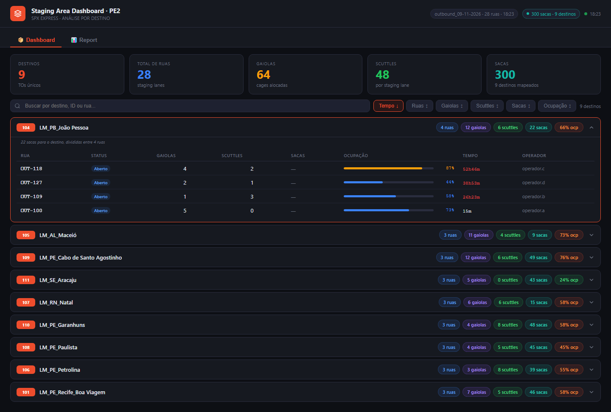
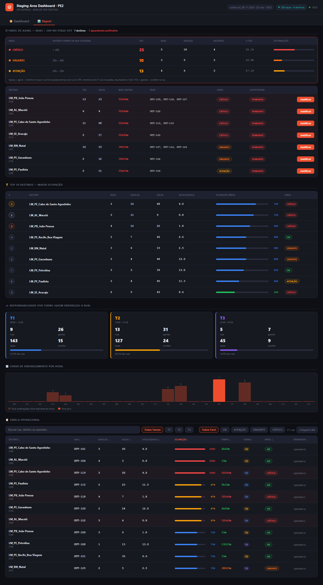

# 01 · Staging Area Dashboard (Stage OUT)

Painel das **ruas de expedição (staging outbound)**: quanto cada destino tem parado nas ruas, ocupação,
gaiolas, scuttles e sacas, e há quanto tempo. A aba **Report** traz o farol de aging (ruas há mais de 24h),
o registro de **justificativas**, ranking de ocupação, responsabilidade por turno e a tabela operacional.

| | PE2 | PE4 |
|---|---|---|
| Web app | [abrir](https://script.google.com/a/macros/shopee.com/s/AKfycbzHHMx-OIPcZVzcopNUia59oZoNFAvdbZPulURMPOKkyV53SYpcqkUYpsTOp3DIa25LuA/exec) | [abrir](https://script.google.com/a/macros/shopee.com/s/AKfycbyBGhseVjSCIGpDwTUxmjNc6aThRaxSZhIjOIptAD01fTdodydz8oCuMggxQbsh-NLIRg/exec) |
| Planilha | [Stage OUT - PE2](https://docs.google.com/spreadsheets/d/1YWwbGW_Nn7GzIFDtUxPqKixpKDEoyfCwzHdLmviGUFY/edit) | [Stage OUT - PE4](https://docs.google.com/spreadsheets/d/1iDoTjbpZ1pZjJSg2zLNiQhROvDWJ_WGD1stWLAD9364/edit) |
| Projeto Apps Script | [editor](https://script.google.com/home/projects/1GZfijTr7q3rEExAtjw1tETqtRynImNyuT-9zFYoDozamBLlgdbKsO-wD/edit) | [editor](https://script.google.com/home/projects/1GnrUXP1e0u66jjapUtMlm1DTh-Q2ZmzugAgwal84jXPBOHwmGajQflrf/edit) |

| Dashboard | Report |
|---|---|
|  |  |

## Estrutura dos arquivos

```
01-stage-out/
├── pe2/ e pe4/          (mesmo código; muda SHEET_ID e o título no Code.gs)
│   ├── Code.gs          servidor: leitura das abas, cache, justificativas
│   ├── Index.html       layout: cabeçalho, abas Dashboard/Report, modais
│   ├── Styles.html      CSS (inclui os estilos sr-* do Report)
│   ├── JavaScript.html  aba Dashboard (cards por destino, modal da rua)
│   ├── Report.html      aba Report (farol, justificativas, top 10, turnos, curva, tabela)
│   ├── appsscript.json  manifesto (America/Recife, web app DOMAIN / USER_DEPLOYING)
│   └── .clasp.json      scriptId
└── dados/pe2, dados/pe4 CSV das abas (Stage_OUT, Packed, Justificativas) + _resumo.csv
```

## Fontes de dados

| Aba | Uso | Campos usados |
|---|---|---|
| **Stage OUT** | uma linha por rua (mesmos campos da API *Staging Area Outbound* do SPX) | `staging_area_id`, `staging_area_name`, `staging_area_status`, `capacity`, `operator`, `to_destination` (`[id]nome`), `transport_order_quantity` (scuttles), `cage_quantity` (gaiolas), `occupancy_percentage`, `staging_duration_time` (s), carimbo `Atualizado:` no cabeçalho |
| **Packed** | TOs fechadas — dá a contagem de **sacas por destino** | `to_number`, `dest_station_id`, `pack_name` (conta quando contém "saca"), `quantity`, `receiver`, `complete_time` |
| **Justificativas** | criada pelo próprio painel na 1ª justificativa | `data`, `chave`, `rua_id`, `rua`, `destino`, `farol`, `tempo_h`, `motivo`, `observacao`, `responsavel`, `usuario` |

Funções do servidor (chamadas pela página): `getStageOut()`, `getCageData()`, `getRuaDetail(id)`,
`getJustificativas()`, `salvarJustificativa(obj)`.

## Atualização dos dados

- `getStageOut` e `getCageData` passam pelo cache (gatilho `aquecerCache` a cada **1 min**).
- A página consulta: ruas a cada **15 s**, sacas a cada **60 s**, justificativas a cada **60 s**; o Report é
  redesenhado a cada 30 s quando está aberto. Só redesenha o Dashboard quando o carimbo `Atualizado:` muda.
- `getRuaDetail` e as justificativas leem a planilha na hora (sem cache).

## Regras de negócio e cálculos

**Dashboard**
- Entram só ruas com status **1 (Aberto)** ou **3 (Em carregamento)**.
- Ruas agrupadas pelo destino (`[id]` de `to_destination`).
- **Ocupação do destino** = Σ (ocupação% × capacidade) ÷ Σ capacidade das ruas.
- **Tempo** do destino = maior `staging_duration_time` entre as ruas. Cor: > 12h amarelo, > 24h vermelho.
- **Sacas:** vêm por destino (aba Packed). A coluna Sacas da rua só aparece quando o destino tem **uma
  única rua**; com várias ruas, o total fica no badge do destino.
- Clique na rua → modal com a rua e as sacas Packed daquele destino.

**Report**
- **Farol de aging** (sobre ruas ocupadas, pelo tempo da rua): OK < 24h · Atenção 24–36h · Urgente 36–48h ·
  Crítico > 48h. TOs = gaiolas + scuttles da rua.
- **Justificativa** é por rua. A chave é `rua_id | início da ocupação arredondado a 15 min`; quando a rua
  esvazia e é ocupada de novo, ela volta a pedir justificativa. Status do destino: PENDENTE (nenhuma rua
  justificada) · N PENDENTE(S) · JUSTIFICADO.
- **Sacas por rua (estimadas):** sacas do destino repartidas entre as ruas pelo nº de gaiolas.
- **Turno da rua** = turno da hora estimada de início (`agora − tempo da rua`).
- **Top 10** por ocupação média do destino; **curva** = ruas por hora estimada de endereçamento.

## Dependências e configuração

- `Code.gs → CONFIG`: `SHEET_ID`, `ABA_STAGE` (`Stage OUT`), `ABA_SACAS` (`Packed`), `PACK_SACA` (regex do
  tipo saca), `CACHE_SEG`.
- Motivos de justificativa: `SR_MOTIVOS` em `Report.html`. Limite do farol: `SR_FAROIS` / `SR_ALERTA_H`.
- Sem bibliotecas externas.

## Como executar, manter e ajustar

Ver o guia comum no [README principal](../../README.md#manutenção-vale-para-todos-os-painéis).
Ajustes frequentes:
- **Mudar as faixas do farol** → `SR_FAROIS` em `Report.html` (e o texto do critério).
- **Novo motivo de justificativa** → `SR_MOTIVOS`.
- **Coluna nova na aba Stage OUT** → já chega na página (o servidor envia todas as colunas do cabeçalho);
  se for numérica, inclua em `NUMERICOS` no `Code.gs`.
- **Auditoria das justificativas** → aba `Justificativas` da planilha (uma linha por rua justificada).
