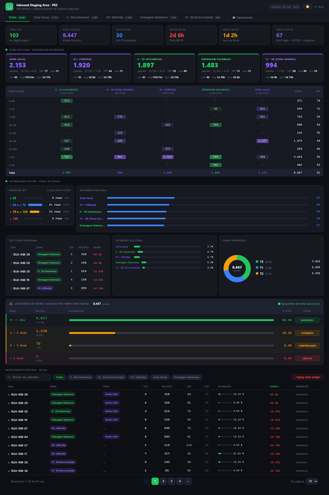
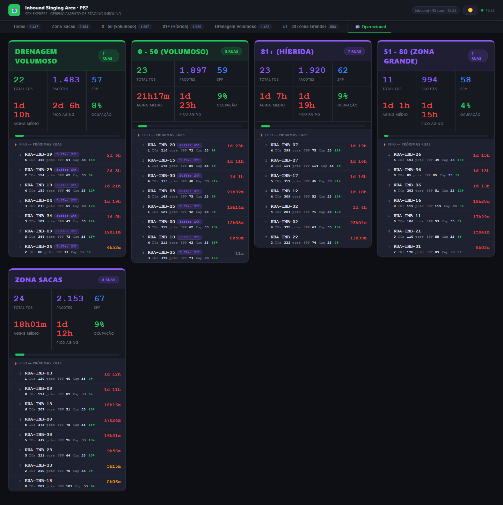

# 02 · Inbound Staging Area (Stage IN)

Painel das **ruas de recebimento (inbound staging)**: TOs e gaiolas por rua e zona, pacotes, **SPP**
(pacotes por unidade), aging, criticidade do backlog, visão dedicada da **Zona Volumoso** e uma visão
**Operacional** (cards por zona com a fila FIFO das próximas ruas).

| | PE2 | PE4 |
|---|---|---|
| Web app | [abrir](https://script.google.com/a/macros/shopee.com/s/AKfycbzJaq4X3EfyNhmFu_bMYBWdefIbQz1lzHwyZ-DPsFFt2vKfuHK8nF8WukuBM9Dvh0qm/exec) | [abrir](https://script.google.com/a/macros/shopee.com/s/AKfycbz1KeC2LE6OOVV6VOw61Rmo-wwtYhBq1TAcuH3EgcQ9eCBktNIge2H01S6-lDF68-f7aw/exec) |
| Planilha | [Stage IN PE2](https://docs.google.com/spreadsheets/d/1eYzK7P5vU5ss2e8OapEzOUPGECXMOl4KKee6WTifHrQ/edit) | [Stage IN PE4](https://docs.google.com/spreadsheets/d/1toQyHNQKDoj9_JhJVVUMm3PS-XkaS5VM_3zFY7tKHH0/edit) |
| Projeto Apps Script | [editor](https://script.google.com/home/projects/1w_M3VcLbziJy1G43zxT-8_Dybr6_FHoQlnodMT72-Z4fd1xE2enIzJp9/edit) | [editor](https://script.google.com/home/projects/1TabT54rvg99wFNV9S8RUnqcEi1VMH6ROne7bASSza02DA2ySWlzirvbB/edit) |

| Todas as zonas | Operacional |
|---|---|
|  |  |

## Estrutura dos arquivos

```
02-stage-in/
├── pe2/ e pe4/          (mesmo código; muda SHEET_ID e UNIDADE no Code.gs)
│   ├── Code.gs          leitura das abas Stage IN e Consulta, agregações, cache
│   ├── Index.html       layout (abas por zona, visões Todas/Volumoso/Operacional, tabela)
│   ├── Styles.html      CSS (tema claro/escuro)
│   ├── JavaScript.html  toda a lógica da tela
│   ├── appsscript.json · .clasp.json
└── dados/pe2, dados/pe4 CSV das abas Stage_IN e Consulta + _resumo.csv
```

## Fontes de dados

| Aba | Uso | Campos usados |
|---|---|---|
| **Stage IN** | uma linha por rua (campos da API *inbound_staging_area*) | `area_id`, `area_name`, `capacity`, `status`, `to_quantity`, `cage_quantity`, `operator`, `occupy_percentage`, `staging_duration_time`, `staging_group_name` (zona), carimbo `Atualizado:` |
| **Consulta** | uma linha por TO/gaiola dentro das ruas (faz o papel do antigo "Report") | `mapping_item_number` (TO ou `CG…` = gaiola), `staging_area_name`, `group_name`, `aging_hours` (vírgula decimal), `num_packs_in_staging`, `last_update` |

Funções do servidor: `getStageIn()` e `getReportData()` → `{byZone, byArea, byAreaTOs, byTurno, rowCount}`.

## Atualização dos dados

Cache renovado pelo gatilho `aquecerCache` a cada **1 min**; a página consulta a cada **15 s** e só
redesenha quando muda o carimbo da aba Stage IN ou o `geradoEm` da Consulta.

## Regras de negócio e cálculos

- **TO duplicada** na Consulta: vale a última linha.
- **Hora de endereçamento** = `last_update − aging_hours`; o **turno** da TO sai dessa hora.
- **Gaiolas** (`CG…`) entram nos pacotes, mas a API não as conta em `to_quantity`; por isso
  **SPP = pacotes ÷ (TOs + gaiolas)** da rua/zona.
- **Faixas de SPP:** ≤ 30 · 31–70 · 71–150 · > 150 (clicáveis, filtram a tabela).
- **Cross-tab de aging** por zona: faixas 0–4h, 4–7h, 7–10h, 10–13h, 13–16h, 16–21h, 21–25h, 1–2d, 2–3d,
  3–4d, > 4d (pelo tempo da rua; sem ele, pelo maior aging das TOs).
- **Criticidade de aging (pacotes):** 0–1 dia Saudável · 1–2 dias Atenção · 2–3 dias Controlado/Crítico/RISCO
  SLA (≤1% / ≤3% / >3%) · > 3 dias Crítico/PERIGO (≤1% / >1%).
- **Cor do aging da rua:** < 4h normal · 4–7h amarelo · 7–13h laranja · > 13h vermelho.
- **Visão Volumoso** (zonas com "volumoso" no nome): limite de **40 pacotes por TO** (`PCT_THRESHOLD`) —
  TOs acima disso são "pesadas"; turno ofensor e top 5 olham só as pesadas. Botão "Copiar Report" gera o
  texto para o Seatalk com o link do web app.
- **Área (sub-classificação):** COP/LMH pelo nome da zona; ruas `IN-01V…16V` Buffer Termoplástica,
  `IN-17V…35V` HS Volumoso, `LN-*` Buffer Linear, demais Volumoso = Buffer LMH (`getAreaLabel`).
- **Tabela:** só ruas com status 1 (disponíveis); clique expande as TOs da rua.

## Dependências e configuração

- `Code.gs → CONFIG`: `SHEET_ID`, `UNIDADE`, `ABA_STAGE`, `ABA_TOS`, `CACHE_SEG`; `TURNOS` (horários).
- `JavaScript.html`: `PCT_THRESHOLD`, `BINS`, `VOL_BINS`, faixas da criticidade em `buildAgingCrit`.
- Sem bibliotecas externas. Não há perfil de pacote (PP/P/M/G) nem aba de destinos: a planilha não tem
  essas informações (as seções somem sozinhas).

## Como executar, manter e ajustar

Guia comum no [README principal](../../README.md#manutenção-vale-para-todos-os-painéis). Ajustes:
- **Nova zona** → nada a fazer (as abas de zona saem dos dados). Para cor/rótulo próprios, ver `zoneKey` e
  `getAreaLabel`.
- **Limite de TO pesada** → `PCT_THRESHOLD`.
- **Regra de turno** → `TURNOS` no `Code.gs`.
