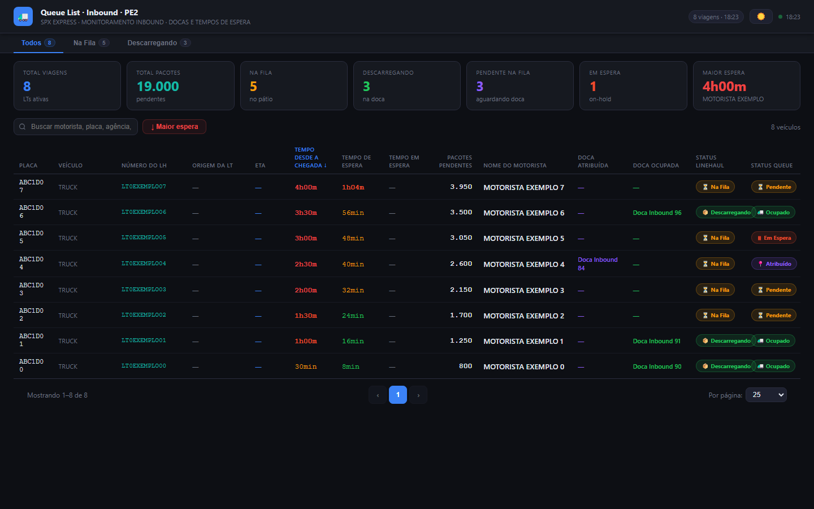

# 03 · Queue List · Inbound

Painel da **fila de veículos do inbound**: quem está no pátio, há quanto tempo, quantos pacotes traz,
doca atribuída/ocupada e status da fila. Clique numa linha abre o detalhe da viagem.

| | PE2 | PE4 |
|---|---|---|
| Web app | [abrir](https://script.google.com/a/macros/shopee.com/s/AKfycbyd5D6sA2tuRHzoTgp4pRwTXVSqK337qHs3zOdn41jCNWntgBTG3M6AtU6QK-7Hs71wYg/exec) | [abrir](https://script.google.com/a/macros/shopee.com/s/AKfycbyo55xuNfibeRthH5SfgoKRE65Mo4RaOxmg3OOeq52Sq9J9_WNajxA8q1293DRpnyn_Bw/exec) |
| Planilha | [Queue list PE2](https://docs.google.com/spreadsheets/d/1sDr6qxgBAcUIrgZ6S9t5O21dxDAHPFfWhbUoQEaS4OQ/edit) | [Queue list PE4](https://docs.google.com/spreadsheets/d/1EKYXxW3rbpTsI3UQ3mlMRc5ZP7QDC9Q-ksc04rrIEIY/edit) |
| Projeto Apps Script | [editor](https://script.google.com/home/projects/1Cc6_HjjGL2_fIfymh6YSq2m4PIImbagfs1ajIM37uLyjkgZWw61KkmK1/edit) | [editor](https://script.google.com/home/projects/1CE-kabqeiGjM-XO71Vgqz_Bchl4IzmHMzQBzRgbpjBLpcT3k8qDVqxn3/edit) |



## Estrutura dos arquivos

```
03-queue-list/
├── pe2/ e pe4/   Code.gs · Index.html · Styles.html · JavaScript.html · appsscript.json · .clasp.json
└── dados/        CSV das abas Inbound_Queue_List e Stage_IN (log) + _resumo.csv
```

## Fontes de dados

| Aba | Uso | Campos usados |
|---|---|---|
| **Inbound Queue List]** (o `]` faz parte do nome) | fila (campos da API *inbound queue list*); guarda histórico | `queue_id`, `queue_number`, `queue_status`, `driver_name`, `vehicle_number`, `vehicle_type_name`, `agency`, `lh_trip_number`, `lh_trip_name`, `order_quantity`, `add_to_queue_time`, `waiting_time`, `on_hold_time`, `assigned_dock_name`, `occupied_dock_name` |
| **Stage IN** | log de eventos da fila (Create/Occupy/Release, inbound e outbound) | **não é usada** pelo painel (pode servir para hora exata de encostar na doca) |

Função do servidor: `getQueueData()` → `{ queue: {list}, trips: {fetchedAt, list: []} }`.

## Atualização dos dados

Cache renovado a cada **1 min** (`aquecerCache`); a página consulta a cada **15 s** e redesenha quando o
carimbo `Atualizado:` da aba muda.

## Regras de negócio e cálculos

- A aba é histórica: por `queue_id` fica só a entrada **mais recente** (`add_to_queue_time`).
- Entram só filas **ativas**: status 1 Pendente · 2 Atribuído · 3 Ocupado · 5 Em espera (4 = Liberado sai).
- A planilha **não tem a API de trips** (ETA, origem, status do linehaul). O servidor monta a "viagem" a
  partir da fila: chegada = `add_to_queue_time`; status **Descarregando** se ocupa doca (status 3), senão
  **Na Fila**. Por isso **Origem da LT** e **ETA** aparecem "—" e o modal não tem a parte de origem/peso.
- Sem `lh_trip_number`, o `queue_number` vira o identificador (o veículo não some da tela).
- **Pacotes pendentes** = `order_quantity`.
- **Cor do tempo de espera:** < 30 min verde · < 60 amarelo · < 120 laranja · ≥ 120 vermelho.
- KPIs: total, pacotes, na fila, descarregando, pendente (status 1), em espera (status 5), maior espera.

## Dependências e configuração

- `Code.gs → CONFIG`: `SHEET_ID`, `UNIDADE`, `ABA_QUEUE`, `ATIVOS` (status considerados), `CACHE_SEG`.
- Sem bibliotecas externas.

## Como executar, manter e ajustar

Guia comum no [README principal](../../README.md#manutenção-vale-para-todos-os-painéis). Ajustes:
- **Ter ETA/origem** → incluir na planilha uma aba com a API de trips e devolver em `trips.list` no
  `montarQueue_()` (a página já trata trips como fonte primária).
- **Limites de cor da espera** → `waitClass()` no `JavaScript.html`.
