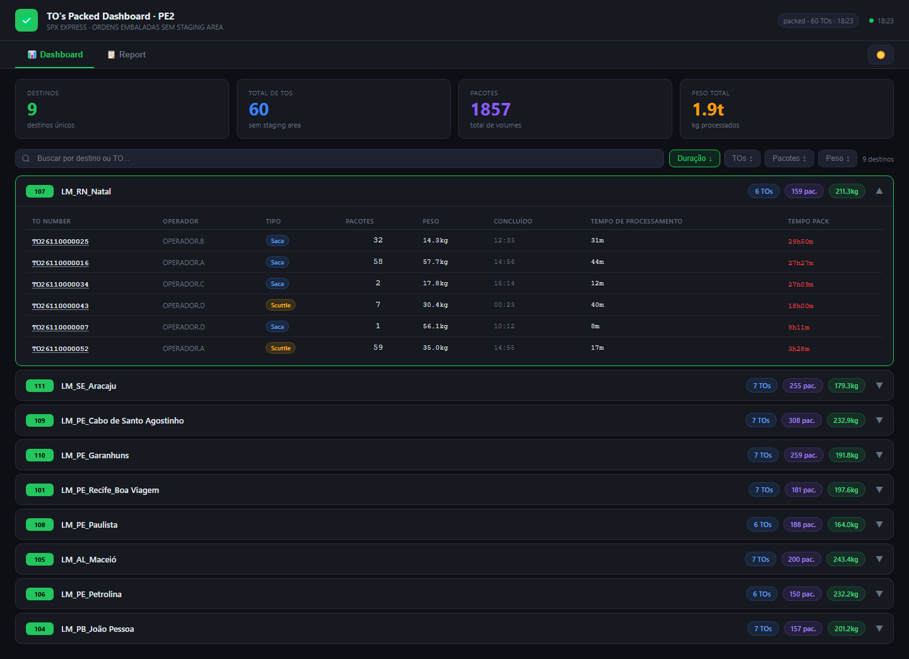
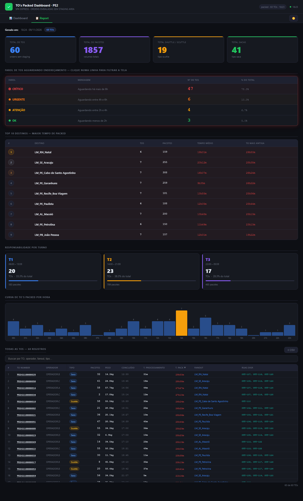

# 04 · TO's Packed Dashboard

Painel das **TOs já embaladas (Packed) que ainda não foram endereçadas numa rua do stage out**: quanto
está parado por destino e há quanto tempo. A aba **Report** traz farol de espera, top 10 destinos,
responsabilidade por turno, curva por hora e a tabela de todas as TOs com as **ruas disponíveis** do destino.

| | PE2 | PE4 |
|---|---|---|
| Web app | [abrir](https://script.google.com/a/macros/shopee.com/s/AKfycbyEuVftFQvcd66LW3A3MBe0sETox3kmT4LUnyfAtG5n6J81TwD3tGPt3fo1BSlhwQM/exec) | [abrir](https://script.google.com/a/macros/shopee.com/s/AKfycbxDo43TOdwQhvc6_U1hO9Nso8KbfyQVEfWcQ4_Sv2FNboVGBeyzquuD0rDNpIjyTFC-/exec) |
| Planilha | [Packed PE2](https://docs.google.com/spreadsheets/d/1PtjTH54K4SgdoghDifedn-SIQurw3ui1tJOi8RAJM5c/edit) | [Packed PE4](https://docs.google.com/spreadsheets/d/14fV7S7EJL5i65ii1uziVxqlZuv9O4nDDwfiy7N31V5A/edit) |
| Projeto Apps Script | [editor](https://script.google.com/home/projects/1JJEh6sXbh0QbPpPiMyQIxb7jrB33Hnn67ZGRAZytlVCfdbd8JIm1gNbZ/edit) | [editor](https://script.google.com/home/projects/1NGwtsrhpWHXd-zM3-yRlugjHz4RegOi0ajpS6TZrnYEcxFX43NSiWFCk/edit) |

| Dashboard | Report |
|---|---|
|  |  |

## Estrutura dos arquivos

```
04-tos-packed/
├── pe2/ e pe4/   Code.gs · Index.html · Styles.html · JavaScript.html · appsscript.json · .clasp.json
└── dados/        CSV das abas Packed e Stage_OUT + _resumo.csv
```

## Fontes de dados

| Aba | Uso | Campos usados |
|---|---|---|
| **Packed** | TOs com status Packed (campos da API *general_to/outbound/search*) | `to_number`, `ctime`, `complete_time`, `operator`, `sender`, `current_station_name`, `receiver`, `dest_station_id`, `dest_station_name`, `weight` (g), `quantity`, `pack_name`, `status`, `staging_area_id`, `lh_trip_number`, `display_direction` |
| **Stage OUT** | ruas do outbound, para a coluna "Ruas Disp." | `staging_area_name`, `to_destination`, `occupancy_percentage` |

Funções do servidor: `getTosPacked()` e `getStageOut()` (datas `yyyy-MM-dd HH:mm:ss` convertidas em
segundos Unix no fuso da planilha).

## Atualização dos dados

Cache renovado a cada **1 min**. A página consulta a cada **15 s** (ruas a cada 30 s), mas só **redesenha a
cada 5 min** (`RENDER_THROTTLE_MS`), para a tela não "pular" a cada atualização; a primeira carga é imediata.

## Regras de negócio e cálculos

- Só entram TOs **sem staging area** (`staging_area_id` vazio ou `-`).
- Some da tela a TO com mais de **36 h** desde a conclusão (`MAX_AGE_HOURS`) — provável endereçamento não
  refletido no SPX.
- Some a TO que **já saiu da estação**: `sender ≠ current_station_name` e mais de **2 h** de idade.
- **T. Pack (espera)** = agora − `complete_time`; **T. Processamento** = `complete_time − ctime`.
  Cor: > 30 min amarelo, > 2 h vermelho.
- **Farol (Report):** OK ≤ 2h · Atenção 2–4h · Urgente 4–6h · Crítico > 6h. Clique numa linha filtra
  todo o Report.
- **Turno** = hora de `complete_time` (T1 06–14, T2 14–22, T3 22–06).
- **Ruas disponíveis** = ruas do destino com ocupação < 100% (aba Stage OUT); sem nenhuma → "CHEIO".
- **Peso:** `weight` em gramas, exibido em kg/t.
- Clique no número da TO → detalhe da TO com os dados da planilha.

## Dependências e configuração

- `Code.gs → CONFIG`: `SHEET_ID`, `UNIDADE`, `ABA_TOS`, `ABA_STAGE`; `CAMPOS_TOS` (colunas enviadas).
- `JavaScript.html`: `MAX_AGE_HOURS`, `TRANSBORDO_GRACE_SEC`, `RENDER_THROTTLE_MS`, faixas do farol em
  `renderReport()`.
- Sem bibliotecas externas.

## Como executar, manter e ajustar

Guia comum no [README principal](../../README.md#manutenção-vale-para-todos-os-painéis). Ajustes:
- **Usar outra coluna da aba Packed** → acrescente em `CAMPOS_TOS` (e em `NUM_TOS`/`DATAS_TOS` se for
  número/data).
- **Tela mais "ao vivo"** → diminua `RENDER_THROTTLE_MS`.
