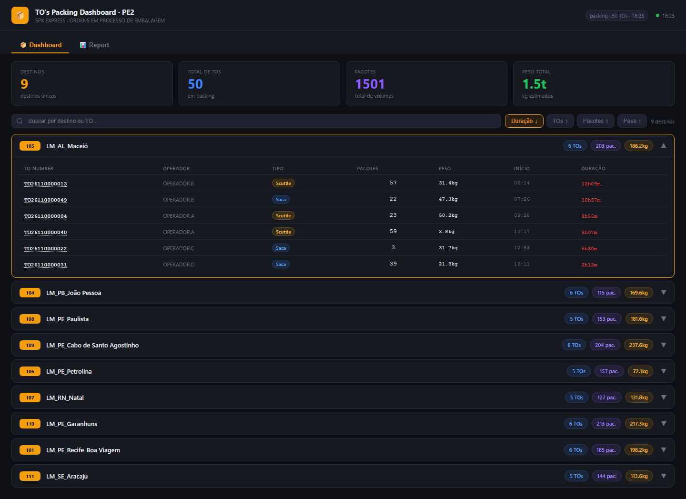
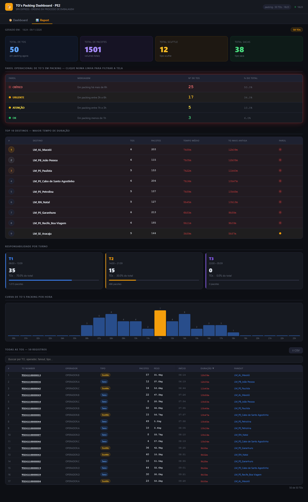

# 05 · TO's Packing Dashboard

Painel das **TOs em processo de embalagem (status Packing)**: o que está aberto por destino e há quanto
tempo. A aba **Report** traz farol operacional, top 10 destinos por duração, turnos, curva por hora e a
tabela de todas as TOs.

| | PE2 | PE4 |
|---|---|---|
| Web app | [abrir](https://script.google.com/a/macros/shopee.com/s/AKfycby7yXnsVuZR5pC7lXPk6q6L_bVb4OoqpM7if0fdWOWlZUBP9ZTs2tbUNURNQm9YahEB/exec) | [abrir](https://script.google.com/a/macros/shopee.com/s/AKfycbwHppGkkWEuLaeOk5YU2yBmzp-_T6kC2_WEhRL37A7m4IZ_Sah3Rq2mq0QY1QerCyNY/exec) |
| Planilha | [Packing PE2](https://docs.google.com/spreadsheets/d/1kYFVON190UYh4XiDnR0923w1tsp8E43lVBqtCiZTZzs/edit) | [Packing PE4](https://docs.google.com/spreadsheets/d/13aFCuxkrZf-45mc_lgfsQA2KjlBkhIDdYoolkfHpsY8/edit) |
| Projeto Apps Script | [editor](https://script.google.com/home/projects/1UQgJ9L2k5iV-U2g1UOkOViqsDf_lU0pHOROxtujG0lMYt4oBcOuuguDP/edit) | [editor](https://script.google.com/home/projects/1kYkuLc6drl6j2ydI-VRoqKlApN0aALUkP1eqEgEHKMn4rPmfDo2HhPHg/edit) |

| Dashboard | Report |
|---|---|
|  |  |

## Estrutura dos arquivos

```
05-tos-packing/
├── pe2/ e pe4/   Code.gs · Index.html · Styles.html · JavaScript.html · appsscript.json · .clasp.json
└── dados/        CSV das abas Packing e Stage_OUT + _resumo.csv
```

## Fontes de dados

| Aba | Uso | Campos usados |
|---|---|---|
| **Packing** | TOs em embalagem (campos da API *general_to/outbound/search*) | `to_number`, `ctime` (início), `operator`, `sender`, `receiver`, `dest_station_id`, `dest_station_name`, `weight`, `quantity`, `pack_name`, `status`, `lh_trip_number`, `display_direction` |
| Stage OUT | existe na planilha, **não é usada** por este painel | — |

Função do servidor: `getTosPacking()`.

## Atualização dos dados

Cache renovado a cada **1 min**; a página consulta a cada **15 s** e redesenha quando o carimbo
`Atualizado:` muda.

## Regras de negócio e cálculos

- Só entram TOs com status **Packing**.
- Some a TO com mais de **24 h** em packing (`MAX_AGE_HOURS`) — quase certamente já concluiu e a linha
  ficou na planilha.
- **Duração** = agora − `ctime`. Cor: > 30 min amarelo, > 2 h vermelho.
- **Farol (Report):** OK < 1h · Atenção 1–3h · Urgente 3–6h · Crítico > 6h. Clique filtra todo o Report.
- **Turno** = hora de `ctime` (início do packing).
- **Peso:** `weight` em gramas ("kg estimados" no card).
- Clique no número da TO → detalhe com os dados da planilha.

## Dependências e configuração

- `Code.gs → CONFIG`: `SHEET_ID`, `UNIDADE`, `ABA_TOS`; `CAMPOS_TOS`.
- `JavaScript.html`: `MAX_AGE_HOURS`, faixas do farol em `renderReport()`.
- Sem bibliotecas externas.

## Como executar, manter e ajustar

Guia comum no [README principal](../../README.md#manutenção-vale-para-todos-os-painéis). Ajustes:
- **Mudar as faixas do farol** → `farolLevels` em `renderReport()` (e o texto da mensagem de cada nível).
- **Corte de TOs antigas** → `MAX_AGE_HOURS`.
