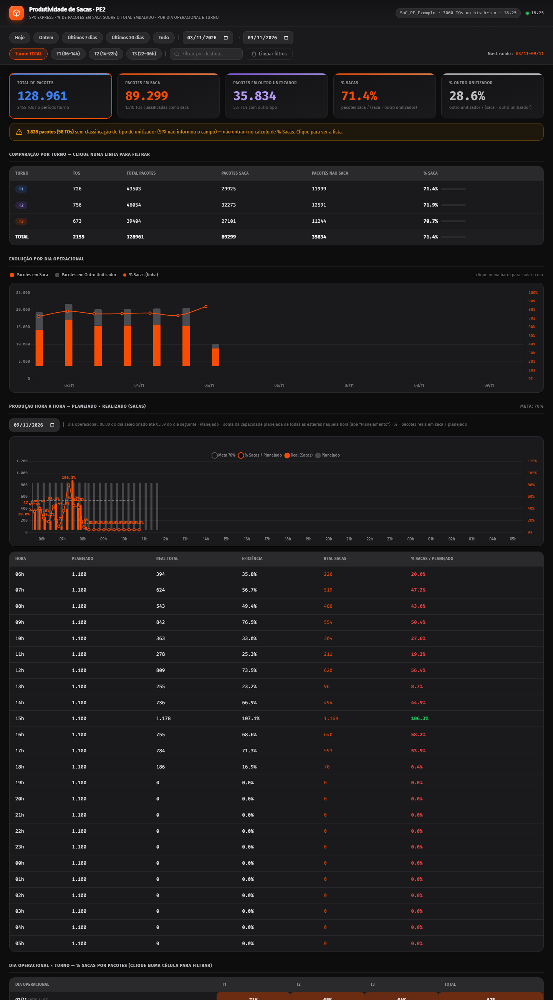

# 06 · Produtividade de Sacas

Mede o **% de pacotes embalados em saca** sobre o total embalado (saca + outros unitizadores), por **dia
operacional** e **turno**, com evolução diária, visão **hora a hora planejado × realizado** (meta 70%),
matriz dia × turno, validação da regra e tabela de auditoria.

| | PE2 | PE4 |
|---|---|---|
| Web app | [abrir](https://script.google.com/a/macros/shopee.com/s/AKfycbwCff3M6jVGI3DbiP3Ce-uwTDNkYScUG_zuOYxaOeRrRo_Ywn47Zutjm0PufWDgFBPo/exec) | [abrir](https://script.google.com/a/macros/shopee.com/s/AKfycbydJnPkhf1EL4ZkLq8jDkx-ZJYci8E9iR72r96R08Q0DwwKsgHYIzljEtefBVTJQUhT/exec) |
| Planilha | [Saca management PE2](https://docs.google.com/spreadsheets/d/1d73wxdpuN4pm_IvomoB70WoPn8X4nZ8O0Kf2gSexz-0/edit) | [Saca management PE4](https://docs.google.com/spreadsheets/d/1FCivD51mADNhBA1J-eZDqdnEHYosf2CP9yQzP0lx3r0/edit) |
| Projeto Apps Script | [editor](https://script.google.com/home/projects/1SPJlLzXllCWkw_NZ3XyLFkVYSpzFwSp60LbaNnxqz4RVF5whJ_XUdG6U/edit) | [editor](https://script.google.com/home/projects/1Lg6bbTkHHNUrKv1F-iXtVQ1WDOEi1Jrm6nKPzQNm2NyyCja24f3TT0lF/edit) |



## Estrutura dos arquivos

```
06-produtividade-sacas/
├── pe2/ e pe4/   Code.gs · Index.html · Styles.html · JavaScript.html · appsscript.json · .clasp.json
└── dados/        CSV das abas Saca_management e Planejamento + _resumo.csv
```

## Fontes de dados

| Aba | Uso | Campos usados |
|---|---|---|
| **Saca management** | histórico de TOs concluídas (dezenas de milhares de linhas) | `dt_complete` (conclusão), `to_number`, `dest_station_name`, `orders` (pacotes), `unitizador` (Saca, Scuttle, …) |
| **Planejamento** | capacidade planejada por data/hora/esteira | `Data` (dd/MM/yyyy), `Hora`, `Tipo processo`, `capacidade` |

Funções do servidor: `getSacasHistory()` (lista **compactada**: dicionário de destinos e de unitizadores +
`[TO, iDestino, pacotes, iUnitizador, conclusão]`, para caber no cache) e `getSacasPlanejamento()`
(capacidade **somada por data+hora**, todas as esteiras).

> **PE4:** a aba Planejamento está praticamente vazia (só o cabeçalho e 1 linha); enquanto não for
> preenchida, a linha "Planejado" do hora a hora fica sem valores.

## Atualização dos dados

Cache renovado a cada **1 min**; a página busca o histórico a cada **30 s** e o planejamento a cada **5 min**.

## Regras de negócio e cálculos

- **Dia operacional:** 06:00 de um dia até 05:59:59 do dia seguinte. **Turnos:** T1 06–14 · T2 14–22 · T3 22–06.
- **Classificação:** `unitizador` = "Saca" → SACA; outro valor → NÃO SACA; vazio → SEM CLASSIFICAÇÃO
  (aviso amarelo, **fora** do cálculo de %).
- **% Sacas = pacotes em saca ÷ (pacotes em saca + pacotes em outro unitizador)** — por **pacotes**, não por
  quantidade de TOs.
- **Hora a hora:** usa data/hora de **calendário** do realizado e a data do **dia operacional** no
  planejamento (a planilha grava 00h–05h com a data do dia operacional). Eficiência = real total ÷
  planejado; % Sacas/Planejado = real em saca ÷ planejado; verde se ≥ meta (70%).
- **Validação:** total = saca + não saca + sem classificação; TOs sem data de conclusão; TOs duplicadas
  (deduplicadas por `to_number`); TOs fora do filtro.
- **Status** sempre "Packed" (a planilha não tem a coluna).

## Dependências e configuração

- `Code.gs → CONFIG`: `SHEET_ID`, `UNIDADE`, `STATION_LABEL`, `ABA_HIST`, `ABA_PLAN`, `CACHE_SEG`.
- `JavaScript.html`: `HOURLY_TARGET_PCT` (meta), regra de turno em `turnoOf`, dia operacional em
  `operationalDayKey`.
- **Externas (CDN):** Chart.js 4.5.1, chartjs-plugin-datalabels 2.2.0, Google Fonts (Fira Sans / Fira Code).

## Como executar, manter e ajustar

Guia comum no [README principal](../../README.md#manutenção-vale-para-todos-os-painéis). Ajustes:
- **Meta** → `HOURLY_TARGET_PCT`.
- **Novo tipo de unitizador que conta como saca** → `classify()` no `JavaScript.html`.
- **Planejamento** → preencher a aba `Planejamento` (uma linha por data/hora/esteira).
