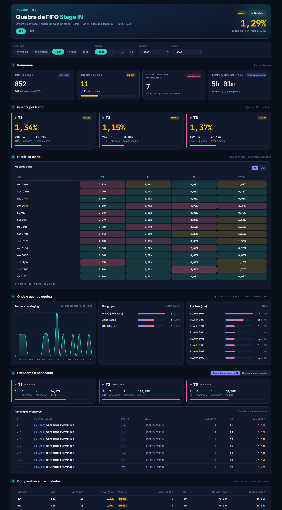

# 07 · Painel FIFO Stage IN (PE2 + PE4)

Mede a **quebra de FIFO no stage de entrada**: TOs que saíram do stage fora da ordem em que entraram.
Mostra o % de quebra por unidade, turno, dia, grupo, área e hora, e cruza os **colaboradores ofensores**
com o **headcount** (turno, líder, ativo/inativo). Um único painel atende PE2 e PE4 (seletor no topo).

| | |
|---|---|
| Web app | [abrir](https://script.google.com/a/macros/shopee.com/s/AKfycbymhO0ljXXcgPygiGrbvtjxC0_1kPpPA49hY8Acf18XSHM_OKHcHlkwfQoC7KA3_U7h/exec) |
| Planilha | [Stage IN - Performace](https://docs.google.com/spreadsheets/d/1fB_CvpryMOy0ZhMLqW1LgJNhkvIKiZqn7k_fstKRJCU/edit) |
| Projeto Apps Script | [editor](https://script.google.com/home/projects/1K3DwOj1bT43k0y4OzUkkVJTmVC_oYXoEazkJcEUC1VgnB7ld0OjD_ybg/edit) |



## Estrutura dos arquivos

```
07-fifo-stage-in/
├── app/
│   ├── Code.gs          leitura das bases e do headcount, compactação, cache
│   ├── Index.html       página inteira (CSS + JS no mesmo arquivo)
│   ├── appsscript.json  manifesto
│   └── .clasp.json      scriptId
└── dados/app/           CSV das abas (headcount com colunas pessoais mascaradas) + _resumo.csv
```

## Fontes de dados

| Aba | Origem | Campos usados |
|---|---|---|
| **Stage IN PE4** / **Stage IN PE2** | IMPORTRANGE da aba Consulta de cada unidade | `adjusted_date`, `mapping_item_number` (TO), `staging_date`, `rank_in`, `stage_out_date`, `rank_out`, `fifo_status`, `turno`, `staging_area_name`, `group_name`, `operator_staging`, `operator_stage_out` |
| **Headcount PE4** / **Headcout PE2** (grafia da planilha) | IMPORTRANGE das bases SOC-PE4 / SOC-PE2 | `OPS ID`, `Nome`, `Turno`, `Status`, `Cargo`, `Setor`, `Líder` — **CPF, e-mail e telefone não são enviados ao painel** |

Função do servidor: `getDados(forcar)` → `{geradoEm, meta, unidades:[{id, nome, rows, grupos, areas, ops, hc}]}`.
As linhas vão compactadas: `[data, turno, quebra(0/1), hora, grupo, área, opEntrada, opSaída, permanência(min), TO, rankIn, rankOut, staging]`.

## Atualização dos dados

Diferente dos outros painéis: cache de **25 min** (`CACHE_SEG: 1500`) renovado pelo gatilho
`aquecerCache` a cada **10 min**. O botão **Atualizar** chama `getDados(true)` e relê a planilha na hora.
Janela enviada: últimos **45 dias** da base (`DIAS`).

## Regras de negócio e cálculos

- **Quebra** = `fifo_status` contém "Not" (Not Respected). **% quebra** = quebras ÷ TOs.
- **Meta:** ≤ 1,00% bom · ≤ 2,00% médio · acima ruim (`META`).
- **Turno da TO** = turno, no headcount, de **quem tirou do stage** (`operator_stage_out`), com prioridade
  para cadastro ATIVO; se o operador não está no HC, vale a coluna `turno` da base. A lógica é a mesma do
  report do Seatalk: quem tira escolhe a ordem de saída, então a quebra é dele.
- **Permanência** = `stage_out_date − staging_date` (minutos).
- **Ofensores:** alternável entre "quem tirou (stage-out)" e "quem colocou (staging)"; mostra % de quebra
  por colaborador, turno, líder e se está fora do HC/inativo.
- **Períodos:** último dia, dia anterior, 7 dias, 15 dias, tudo, ou **personalizado** (campos De / até, dentro dos 45 dias da base); filtros de turno, grupo e área.

## Dependências e configuração

- `Code.gs → CONFIG`: `SHEET_ID`, `UNIDADES` (abas de base e de HC de cada unidade), `DIAS`, `META`, `CACHE_SEG`.
- **Externas (CDN):** Chart.js 4.4.1, Google Fonts (Inter, JetBrains Mono).
- A página aceita `window.MOCK` com o mesmo JSON de `getDados` (usado pelos previews).

## Como executar, manter e ajustar

Guia comum no [README principal](../../README.md#manutenção-vale-para-todos-os-painéis). Ajustes:
- **Meta** → `CONFIG.META` (vale também para as cores do mapa de calor).
- **Nova unidade** → nova entrada em `CONFIG.UNIDADES` com as abas de base e de HC na planilha.
- **Janela maior** → `CONFIG.DIAS` (aumenta o tamanho do JSON/cache).
