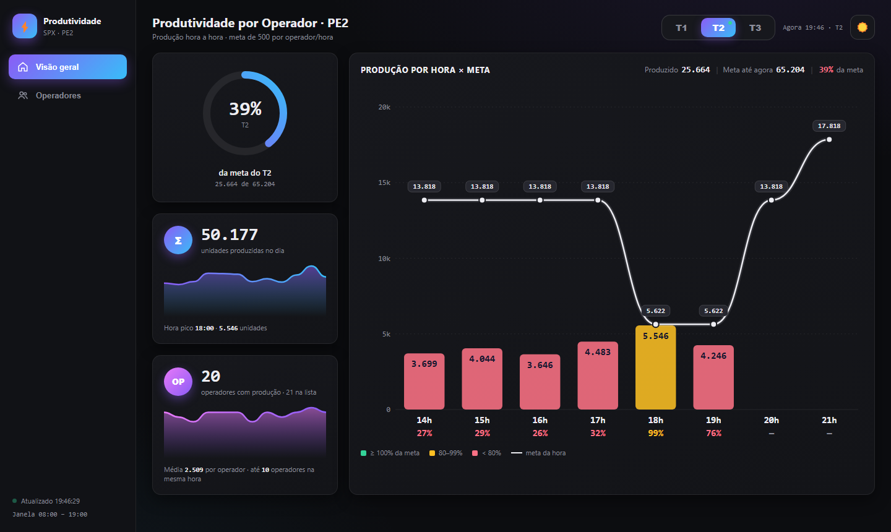
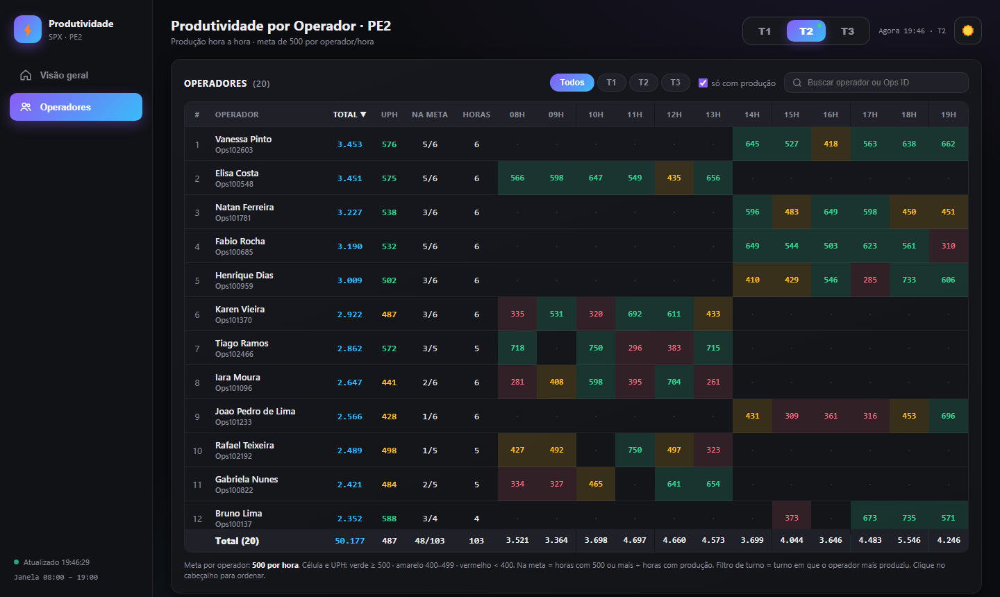

# 08 · Produtividade por Operador

Mostra a **produção hora a hora** da unidade comparada com a **meta da hora** (aba Meta), por turno, e a
produção de cada operador contra a **meta de 500 unidades por hora**.

| | PE2 |
|---|---|
| Web app | [abrir](https://script.google.com/a/macros/shopee.com/s/AKfycbwLQS99GJ8_YhL1JKLwBk7SFyp7owKGzlQElT1GklpNjACbgms_EXZh4oJBb6iafk8J/exec) |
| Planilha | [Produtividade PE2](https://docs.google.com/spreadsheets/d/1ro9a0FBqqtAetLoNS_8M885Dudw1f84jxUa_rI8FYNs/edit) |
| Projeto Apps Script | [editor](https://script.google.com/home/projects/1O09ck43G7a2siM6LCexaQ36CocbAkUisvOSZJy9H5nnhLBD7B-owZEbb/edit) |

> Por enquanto só existe a versão **PE2**. Para o PE4, copie a pasta `pe2/`, troque `SHEET_ID` e `UNIDADE`
> no `Code.gs` e crie o projeto/implantação (ver o README principal).

| Visão geral | Operadores |
|---|---|
|  |  |

## Estrutura dos arquivos

```
08-produtividade-operadores/
└── pe2/
    ├── Code.gs          servidor: lê as abas Productivity e Meta, monta o JSON, cache
    ├── Index.html       layout: menu lateral (Visão geral / Operadores), seletor de turno, cartões, tabela
    ├── Styles.html      CSS (modo escuro e claro)
    ├── JavaScript.html  cálculos e desenho dos gráficos (SVG, sem bibliotecas)
    ├── appsscript.json  manifesto (America/Recife, web app DOMAIN / USER_DEPLOYING)
    └── .clasp.json      scriptId
```

## Fontes de dados

| Aba | Uso | Campos usados |
|---|---|---|
| **Productivity** | uma linha por operador + linha `TOTAL GERAL`; janela de horas móvel (ex.: 09:00–20:00) | `operator` (`[OpsID]NOME`), `efficiency_total`, uma coluna por hora (`HH:00`, da mais recente para a mais antiga), carimbo `Atualizado:` |
| **Meta** | capacidade planejada por data, hora e esteira | `Data` (dd/MM/yyyy), `Hora` (0–23), `Tipo processo` (esteira), `capacidade` |

Função do servidor: `getProdutividade()` →
`{fetchedAt, agora, diaOp, horas, ops:[{id, nome, h:[por hora], total}], geral:{h, total}, meta:{hora: soma}}`.

## Atualização dos dados

Cache renovado pelo gatilho `aquecerCache` a cada **1 min**; a página consulta a cada **15 s** e só redesenha
quando o carimbo `Atualizado:` muda.

## Regras de negócio e cálculos

- **Turnos:** T1 06:00–13:59 · T2 14:00–21:59 · T3 22:00–05:59. **Dia operacional:** 06:00 → 05:59 do dia seguinte.
- **Meta da hora** = soma da `capacidade` de todas as esteiras para o **dia operacional** e a hora (a aba grava
  00h–05h com a data do dia operacional).
- **Meta até agora** (anel e resumo do gráfico) = horas passadas inteiras + a hora atual **proporcional aos
  minutos** + horas futuras não contam. **% da meta** = produzido ÷ meta até agora.
- **Cor da barra / % por hora:** ≥ 100% verde · 80–99% amarelo · < 80% vermelho (`LIMIAR_MELHORAR`).
- **Operadores (aba Operadores):** meta de **500 por hora** (`META_OP_HORA`); célula e UPH verde ≥ 500,
  amarelo 400–499, vermelho < 400. **UPH** = total ÷ horas com produção. **Na meta** = horas ≥ 500 ÷ horas
  com produção. **Turno do operador** (filtro) = turno em que ele mais produziu.

## Dependências e configuração

- `Code.gs → CONFIG`: `SHEET_ID`, `UNIDADE`, `ABA`, `ABA_META`, `CACHE_SEG`.
- `JavaScript.html`: `HORAS_TURNO`, `LIMIAR_MELHORAR` (0,8), `META_OP_HORA` (500), `POLL_MS`.
- Sem bibliotecas externas (gráficos em SVG). O modo claro/escuro fica salvo no navegador (`prodTheme`).
- **Botão "Enviar ao Seatalk":** gera um PNG do gráfico do turno escolhido (com título e resumo), mostra a
  prévia e, ao confirmar, `enviarSeatalk()` manda **só a imagem** ao grupo.
  O webhook **não fica no repositório**: vem da propriedade `SEATALK_WEBHOOK` do script ou, se ela não
  existir, da constante `SEATALK_WEBHOOK_PADRAO` no arquivo `pe2/Segredo.gs` — que vai ao Apps Script pelo
  `clasp push`, mas está no `.gitignore`. Numa máquina nova, crie esse arquivo (ou a propriedade) antes do push.

## Como executar, manter e ajustar

Guia comum no [README principal](../../README.md#manutenção-vale-para-todos-os-painéis). Ajustes:
- **Meta por operador** → `META_OP_HORA`; **faixa amarela** → `LIMIAR_MELHORAR`.
- **Meta por hora** → preencher a aba `Meta` da planilha (uma linha por data/hora/esteira).
- **Horários dos turnos** → `HORAS_TURNO` e `turnoDaHora()`.
